# Diabetic Retinopathy Classification using Machine Learning
**SIH26038 · First machine learning project**

This repo documents every step took, including the things that confused me, so other beginners can follow along. The model classifies retinal images into 5 severity levels of diabetic retinopathy (DR).


## Results at a glance

| Model | Accuracy | Macro F1 |
|---|---|---|
| SVM (baseline) | 0.791 | 0.569 |
| SVM (tuned) | 0.767 | 0.611 |
| **Logistic Regression (tuned), final** | 0.769 | **0.621** |

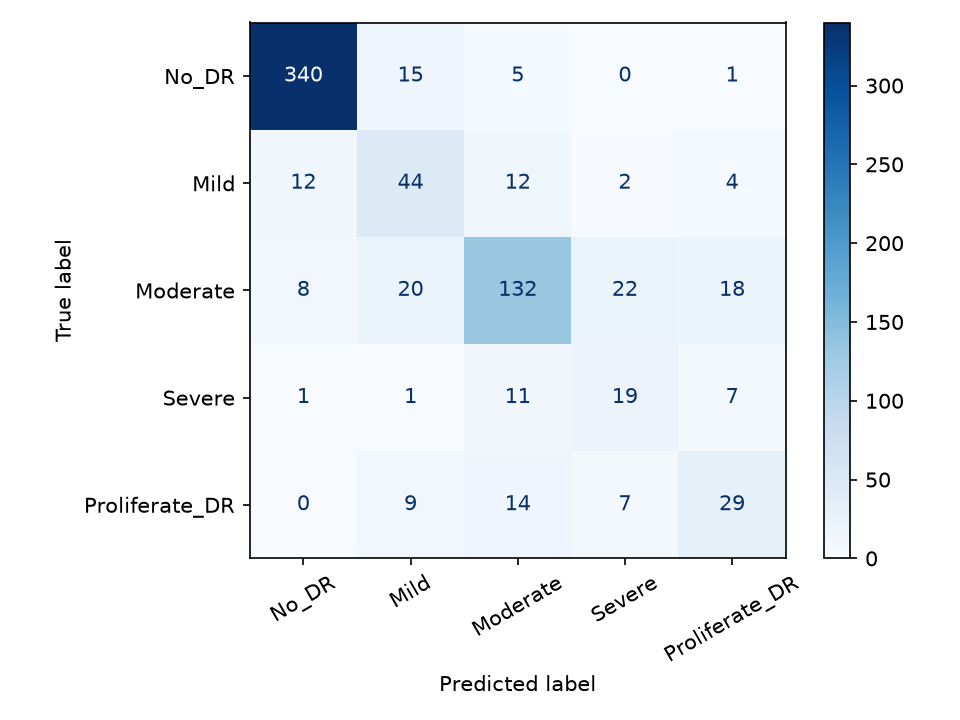

## Contents

1. [Step 1: Setup](#step-1-setup)
2. [Step 2: Getting the data](#step-2-getting-the-data)
3. [Step 3: Exploring the data](#step-3-exploring-the-data)
4. [Steps 4 + 5: Preprocessing and feature extraction](#steps-4--5-preprocessing-and-feature-extraction)
5. [Step 6: Training and evaluating](#step-6-training-and-evaluating)
6. [Step 7: Publishing on GitHub](#step-7-publishing-on-github)
7. [Things that went wrong](#things-that-went-wrong-and-how-we-fixed-them)
8. [Limitations and next steps](#limitations-and-next-steps)

---

## Step 1: Setup

**What and why:** We used Python 3.12 inside a *virtual environment* (venv), a private box of libraries for this project so versions never clash with other projects. We wrote code in VS Code, with Git Bash as the terminal.

```bash
py -3.12 -m venv venv
source venv/Scripts/activate
pip install numpy pandas matplotlib scikit-learn opencv-python torch torchvision jupyter kaggle
```

Checking that everything installed correctly:

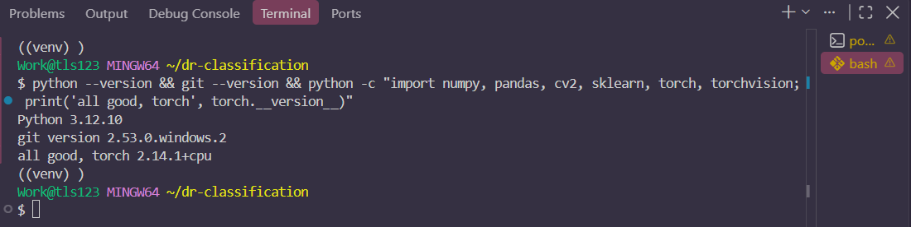

## Step 2: Getting the data

**What and why:** We used the APTOS 2019 retina images, in a version already resized to 224x224 and sorted into one folder per severity class ([dataset link](https://www.kaggle.com/datasets/sovitrath/diabetic-retinopathy-224x224-2019-data)). The original is about 10 GB, and this version is about 240 MB. We downloaded it with the Kaggle command-line tool, which needs an API token. The token is a password for the Kaggle account, so it is never shared or committed.

```bash
kaggle datasets download -d sovitrath/diabetic-retinopathy-224x224-2019-data -p data --unzip
```

Result: 3,662 images in 5 class folders, plus `train.csv`:

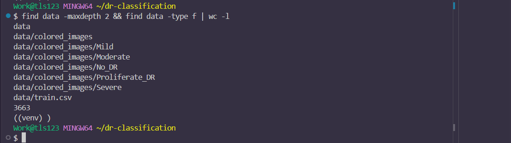

## Step 3: Exploring the data

**What and why:** Before building anything, we checked how many images each class has and what they look like (`explore.py`).

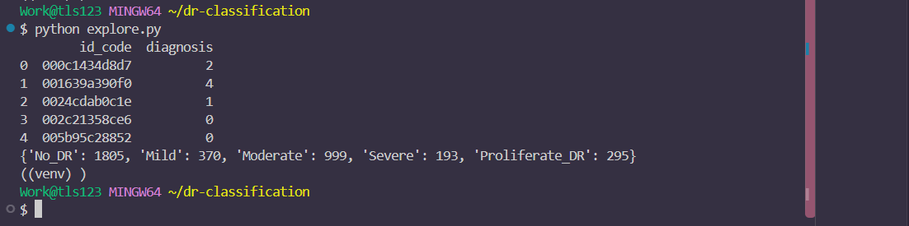

| Class | Images |
|---|---|
| No_DR | 1805 (about 49%) |
| Moderate | 999 |
| Mild | 370 |
| Proliferate_DR | 295 |
| Severe | 193 |

**Key finding:** the classes are imbalanced. A model that always answers "No DR" would already be about 49% accurate, so accuracy alone can't be trusted here.

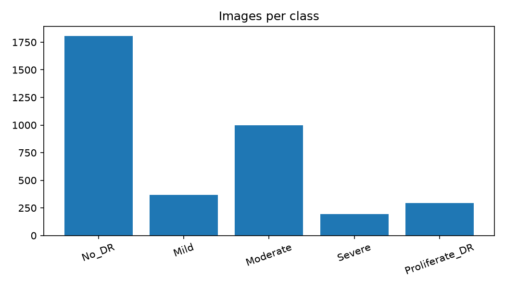

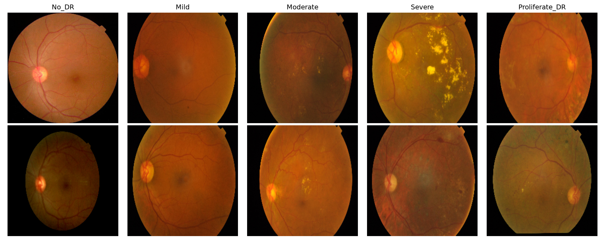

## Steps 4 + 5: Preprocessing and feature extraction

Both happen in one script, `extract_features.py`, because they run in the same loop.

**What and why:** for every image the script:
1. Resizes it to 224x224 (the size ResNet50 expects)
2. Boosts contrast with CLAHE, which makes blood vessels and lesions easier to see
3. Normalizes pixels the way ResNet50 expects (ImageNet mean and standard deviation)
4. Passes it through a **pretrained ResNet50** and keeps the 2048-number "fingerprint" it produces

The features are saved to `features/X.npy` and `features/y.npy`. This slow step runs **once**, so training classifiers afterwards takes seconds.

```bash
python extract_features.py
```

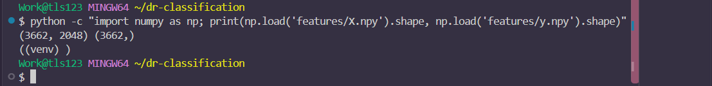

## Step 6: Training and evaluating

**The metrics, explained simply:**
- **Precision:** of the images the model called class X, how many really were X?
- **Recall:** of all the real class X images, how many did the model find?
- **F1-score:** one number balancing precision and recall.
- **Macro F1:** the average F1 across classes, treating rare classes equally. This is the fairest score for imbalanced data.
- **Confusion matrix:** a grid of true class (rows) against predicted class (columns).

**The journey:**

1. **Baseline SVM** (`train_baseline.py`): 79.1% accuracy, which looked good, but it found only 18% of Severe cases. Accuracy was hiding the problem.

   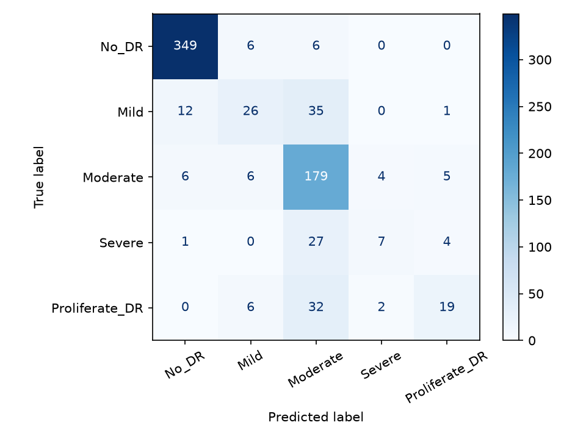

2. **Tuning** (`compare.py`): we tuned SVM and Logistic Regression with 5-fold cross-validation on the training data only, scoring by macro F1.

   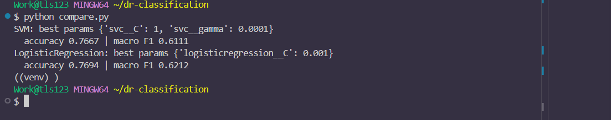

3. **Final model** (`train.py`): Logistic Regression with balanced class weights. It gave up a little accuracy for much better recall on the rare, serious classes:

   | Class | Recall (SVM baseline) | Recall (final) |
   |---|---|---|
   | Mild | 0.351 | 0.595 |
   | Severe | 0.179 | 0.487 |
   | Proliferate_DR | 0.322 | 0.492 |

   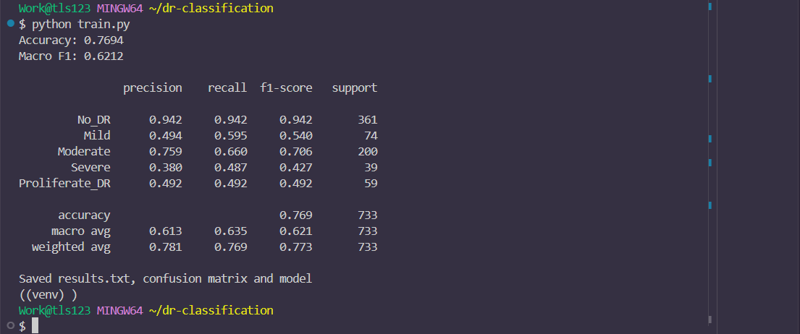

Final per-class results on the test set (733 images):

| Class | Precision | Recall | F1 | Support |
|---|---|---|---|---|
| No_DR | 0.942 | 0.942 | 0.942 | 361 |
| Mild | 0.494 | 0.595 | 0.540 | 74 |
| Moderate | 0.759 | 0.660 | 0.706 | 200 |
| Severe | 0.380 | 0.487 | 0.427 | 39 |
| Proliferate_DR | 0.492 | 0.492 | 0.492 | 59 |


## Step 7: Publishing on GitHub

**What and why:** GitHub stores the project online so others can see it. We first worked locally, then pushed. The cycle below is how every change gets published:

```bash
git add .
git commit -m "describe the change"
git push
```

A `.gitignore` file keeps large or private things out of the repo: the virtual environment, the dataset and the saved features.

## Things that went wrong (and how we fixed them)

| Problem | Cause | Fix |
|---|---|---|
| `pip: command not found` | The virtual environment wasn't active in the new terminal | `source venv/Scripts/activate` |
| Kaggle gave a token string, not `kaggle.json` | Kaggle changed its key format | Saved it as the `KAGGLE_API_TOKEN` environment variable |
| `python explore.py` ran but printed nothing | The file wasn't saved, so it was empty on disk | Press Ctrl+S, then check with `wc -l explore.py` |
| 79% accuracy looked fine, but rare classes were missed | Class imbalance | Balanced class weights, and judging by macro F1 |
| Screenshots didn't show in the README | Windows added a second `.png` to the filenames | Renamed the files with `mv` |
| README was empty on GitHub | It wasn't saved before the commit | Saved with Ctrl+S, then committed and pushed again |

[Add your own mistakes and "aha" moments here.]

## What we learned

- [3-4 bullets in your own words.]

## Limitations and next steps

- Images were downscaled to 224x224 (a pre-resized dataset), which loses fine lesion detail. Full-resolution images with fine-tuning are the planned next step.
- ResNet50 was trained on everyday photos and kept **frozen**. Fine-tuning it on retina images should help.
- Only 193 Severe examples, and neighbouring stages look very alike.
- This is an educational project. It is **not** a medical diagnostic tool.

## Project structure

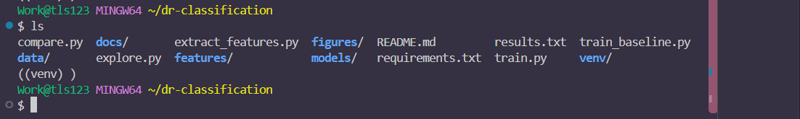

```
dr-classification/
├── explore.py            # Step 3: class counts and sample images
├── extract_features.py   # Steps 4+5: preprocessing + ResNet50 features
├── train_baseline.py     # Step 6: first SVM
├── compare.py            # Step 6: tuning and model comparison
├── train.py              # Step 6: final model and evaluation
├── results.txt           # final metrics
├── requirements.txt
├── figures/              # charts and confusion matrices
├── docs/images/          # screenshots used in this README
└── models/final_model.joblib
```

## How to reproduce

```bash
pip install -r requirements.txt
# download the dataset into data/ (Step 2), then:
python explore.py
python extract_features.py
python train.py
```

## Acknowledgements

Dataset: APTOS 2019 Blindness Detection (Kaggle), resized version by sovitrath. Built with PyTorch (ResNet50), scikit-learn, OpenCV and pandas.